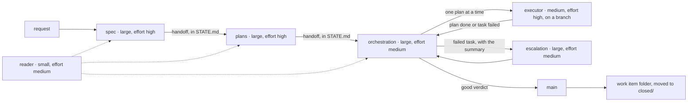
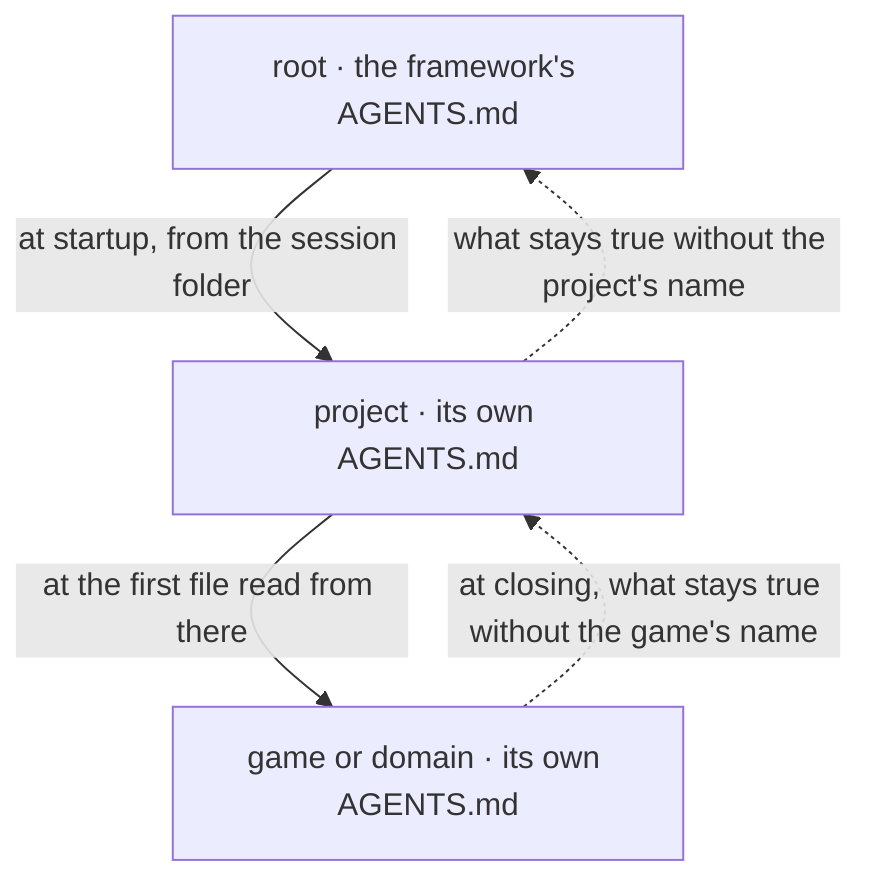
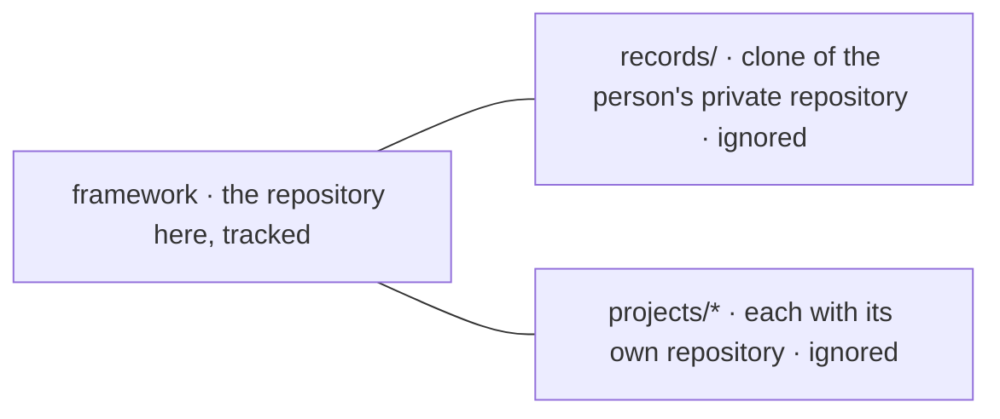

# ai-workspace

A workspace for Claude Code, Antigravity, and other AI coding tools. Work that lasts several days is not lost when a conversation ends. Everything that a new session needs to continue earlier work is in files. The workspace is for projects that do not fit in one conversation. A person works on them alone or in a small team.

This repository holds the **framework**: the rules, the workspace skills, the verification tools, and the template for a new project. Projects live in `projects/`. Each project has its own repository.

## How it works



A request goes through three new sessions. A person opens each session. The sessions are the spec, which is the document that decides what gets built and how, then the plans, then the orchestration.

The orchestrator gives each plan to an **executor**. An executor is an agent of medium tier that the orchestrator starts. The orchestrator checks the plan and merges it into `main`. The orchestrator also gives a task that the executor does not pass to an agent of large tier, called the **escalation**. Between sessions, the **handoff** passes. The handoff is the note in `STATE.md` for the next session. It names the model for each tool, the effort, and the prompt to paste.

The dotted lines show the **reader**. The reader is a small-tier agent. Any session can send it to read web pages, documentation, or broad code searches. It returns only the quotes that the session asked for. Long pages are then not read again at each step of the session.

A plan can also run by hand, in another tool, when the Claude limit is tight. The plan names a tier. The module of that tool says which model the tier means. The orchestrator checks the result in the same way.

A plan with `Closing: the person` enters `main` only after the person says yes. The full rules are in [AGENTS.md](AGENTS.md), for any tool. The rules that belong only to Claude Code are in [CLAUDE.md](CLAUDE.md). The rules that belong only to Antigravity are in [GEMINI.md](GEMINI.md). The rules that belong only to Mistral Vibe are in [MISTRAL.md](MISTRAL.md).

## A full example

A work item of two lines of code goes from request to `main`. Every file that each step leaves is shown. You can read the example without running anything: [example/README.md](example/README.md).

## Quick start

This tutorial takes a new user from an empty folder to their first project, in five steps.

1. **Who it is for.** The environment works on Linux, on any distribution. It is not tested on macOS or on Windows.
2. **What to install.** Install `bash`, `git`, `python3`, `node` and `curl`, with the command for your distribution. On Debian and Ubuntu:

   ```bash
   sudo apt update && sudo apt install -y bash git python3 nodejs curl
   ```

   On Fedora:

   ```bash
   sudo dnf install -y bash git python3 nodejs curl
   ```

   On Arch:

   ```bash
   sudo pacman -Syu --needed bash git python nodejs curl
   ```

   Then install Claude Code, as in the [official install](https://code.claude.com/docs/en/setup). On Linux, the command is:

   ```bash
   curl -fsSL https://claude.ai/install.sh | bash
   ```

3. **How to download.** Clone the repository with git. We recommend this way:

   ```bash
   git clone <repository-url> ai-workspace
   ```

   If you do not use git, download the ZIP archive from GitHub, from the "Code" button. You do not need the history of someone else, `records/`: the restore makes an empty skeleton.
4. **How to start.** Open a terminal in the downloaded folder and run Claude Code:

   ```bash
   cd ai-workspace && claude
   ```

5. **What to paste.** Write the sentence below in the first chat. The welcome skill takes you from there to your first project and to the first spec session.

   ```text
   Start the house tutorial.
   ```

### What to install

The table is the reference for the tutorial. This is the only list of requirements in the documentation. The version is shown next to the command that reads it.

| Requirement | Version | How to read it | What does not work without it |
|---|---|---|---|
| `git` | 2.30 or newer, for `git subtree split` | `git --version` | moving a record with its history |
| `python3` | 3.9 or newer, standard library only | `python3 --version` | every tool in `bin/` |
| `node` | any | `node --version` | the ponytail and RTK hooks. Two of the three plugins are inert. |
| `claude` binary | any | `command -v claude` | checking the restore |
| `gh` | any, authenticated | `gh auth status` | only work with new repositories. The restore does not need it. |
| Antigravity 2.0 and `agy` | any | `agy --version` | only work in Antigravity. The restore skips it when missing. |
| Mistral Vibe, `vibe` | 2.26 or newer, from `uv tool install mistral-vibe` | `vibe --version` | only work in Vibe. The restore skips it when missing. |

### What the restore does

`bin/restore-env.sh` clones each plugin at the SHA in `plugins.lock.json` and places it under `~/.claude/`. The script does not use `claude plugin install`, because that command does not accept a fixed version. It clones over HTTPS, because SSH fails without a key in the agent. It merges the settings in `~/.claude/` instead of rewriting them. It creates the empty skeleton of `records/` when the skeleton is missing. If Antigravity is installed, the script connects it too, with `bin/antigravity.sh`. It does the same for Mistral Vibe, with `bin/vibe.sh`.

## How to adapt

| For | What changes | What to know |
|---|---|---|
| another language | the language rule in the house rules, `records/house-rules.md` | the framework is written in one language. The template is in English. |
| other models | the tier table in the module of the tool: `CLAUDE.md`, `GEMINI.md`, or `MISTRAL.md` | with one model, the sessions stay three. Only the saving of the medium-tier executor is lost. |
| no plugin | `plugins.lock.json`, rebuilt with `bin/make-lock.py` from the installation of the machine, then `restore-env.sh` | without superpowers, the skill order in `AGENTS.md` has nothing to invoke. Without ponytail, code is not kept in check. Without RTK, the output of commands enters the conversation in full. |
| no personal layer | nothing. The framework works without `records/`. | the records stay on one machine, with no history. |
| records in git | a private repository, cloned into `records/` | the framework ignores it. `restore-env.sh` makes the skeleton only when it is missing. |
| local models | the skill `local-workers`, which builds `records/local-workers.md` | without the workers file, execution runs everything in the session. It says why, once. |
| other documentation limits | the constants in `bin/check-docs.py`: 400 lines per document, 70 characters for a repeated phrase, 4 lines per paragraph | the test of the checker fixes these values. Change them together. |
| another project skeleton | `template/` | the tutorial and the guide for a new project copy it whole. |
| a new tool | a module of its own, a row in the tools section of `AGENTS.md`, and a script that connects it | [How to add a new tool](docs/how-to/add-a-new-tool.md) |
| your own rules | `records/house-rules.md`, written by hand. Then run `bin/restore-env.sh` again. It links the file as a user rule for Claude Code, and it includes the file in the local files for Antigravity. | what is personal does not enter the framework. The link stays in HOME, and git ignores the local files. |

## Documentation map

| If | Then | Where |
|---|---|---|
| it is the first meeting | the tutorial, once, with your hands on the keyboard | [First work item, through the three sessions](docs/tutorial/first-work-item.md) |
| a whole work item is wanted, read and not run | the example | [The greeting](example/README.md) |
| a word is not clear | the glossary | [Glossary](docs/reference/glossary.md) |
| the work in progress and what it waits for is sought | the work index | `records/work/INDEX.md` |
| the reason for a rule is sought | the decisions | `records/decisions/INDEX.md` |
| a new project is started | the practical guide | [How to start a new project](docs/how-to/start-a-new-project.md) |
| something in the environment broke | the practical guide | [How to fix an environment problem](docs/how-to/fix-an-environment-problem.md) |
| you work in Antigravity | the reference | [Antigravity](docs/reference/antigravity.md) |
| you work in Mistral Vibe | the reference | [Mistral Vibe](docs/reference/vibe.md) |
| a new tool is added | the practical guide | [How to add a new tool](docs/how-to/add-a-new-tool.md) |
| a document may lag behind its code | the practical guide | [How to keep the documentation current](docs/how-to/keep-documentation-current.md) |
| you measure whether a tool follows the house rules | the reference | [Bench](docs/reference/bench.md) |
| someone already hit this problem | the journal index | `records/journal/INDEX.md` |
| a folder or file is sought | the reference | [Structure of the workspace](docs/reference/structure.md) |
| you need to know what breaks when something is touched | the impact map | [IMPACT.md](IMPACT.md) |
| all the documentation, by kind | the contents | [docs/README.md](docs/README.md) |

## Why it is built this way

### Work lives in files, not in the conversation

A conversation ends, and real work lasts for days. The state file, `STATE.md`, says where the work stopped. The records keep what was decided and what it cost. The folder of a work item keeps the spec and the plan. The explanation is in [Splitting work across models](docs/explanation/splitting-work-across-models.md).

### Three sessions, because rereading the conversation costs

A session is paid per step, and at each step it rereads the whole conversation. The discussion where the requirements are settled is the expensive part. So that discussion ends after the spec. The plans and the orchestration start empty, with only files to read. The plan goes out unprobed. The executor runs it once, at the medium tier. The same explanation covers this.

### Where a session opens, and where what it finds is written



Reading goes down the tree. A session for a project opens in the folder of that project, in any tool. Claude Code loads the rules from the starting folder and from its parents. It loads the rules of a subfolder at the first file read from there. Antigravity gets the rules through the local files of the open folder.

Writing goes up. Each finding is written at the first level that holds it whole.

A new session reads these items, in this order:

1. `AGENTS.md` and the module of the tool. They load by themselves.
2. `STATE.md` of the repository. It shows where the work stopped, and it holds the handoff. The file at the root is local and does not come with the clone.
3. The folder of the work item, in the records of the repository: `README.md`, then the plan.
4. [IMPACT.md](IMPACT.md), before anything changes.

The rules, with their reasons, are in [AGENTS.md](AGENTS.md), under "Session of a project".

### Three kinds of repository, and only one is tracked here



The framework is what is valid on any machine. `records/` is **the personal layer**. It is a clone of a repository that belongs to the person. The records, the agent memory, the house rules, and the local workers describe one person and that person's machines. The framework works whole without the personal layer. The restore makes its empty skeleton.

No tracked file of the framework sends a reader to `records/`. The check `check-docs.py` fails on such a reference, because on another machine the reference is broken. Each project has its own repository. Full detail is in [Structure of the workspace](docs/reference/structure.md).

### One agent at a time

A session starts one subagent at a time. A subagent is another Claude, started from a session. The session starts only the agents of the framework, which are in `agents/`: the executor, the escalation, and the reader.

Agents that start together share the same limit. They all stop at once, and none returns anything. Local workers also run one at a time. The reason is in [Splitting work across models](docs/explanation/splitting-work-across-models.md).

## How it is verified

`tests/` holds the tests of the tools in `bin/`. `./test` runs all of them. It also runs the tests of the projects and of the example. A test that cannot run on this machine exits with 77. The workspace counts that test as skipped, not failed. The verification tools are:

- `bin/check-docs.py`. It checks broken links, documents that no click from `README.md` reaches, repeated phrases, size, and long paragraphs.
- `bin/check-maps.sh`. It checks each checkable row of each `IMPACT.md`.
- `bin/check-lock.sh`. It checks that each SHA in `plugins.lock.json` exists in its repository.
- `bin/values.py`. It checks that no command, path, or figure has disappeared from a rewritten document, compared with a revision.
- `bin/diagrams.html`. It draws the Mermaid diagrams of a document in the browser of the application. Use the configuration `diagrams` in `.claude/launch.json`.

The guides call `/usr/bin/grep` by its full path. This avoids the aliases of the session. The BSD version on macOS is not measured.

## Plugins

Three plugins are pinned. Their versions are read from `plugins.lock.json`:

| Plugin | Layer touched | Why it is here | How to use it |
|---|---|---|---|
| `superpowers` | the order of the work | process skills: brainstorming, plans, TDD, and debugging | invoked by name, `superpowers:<skill>` |
| `ponytail` | how much code is written | a ladder that stops at the first rung that holds | 6 slash commands, plus a permanent mode |
| `rtk-plugin` | how much of a command's output reaches the conversation | a proxy on the development commands | a hook, transparent |

The reference for each plugin is here: [superpowers](docs/reference/superpowers.md), [ponytail](docs/reference/ponytail.md), and [rtk](docs/reference/rtk.md). The skills that the Claude application brings are not pinned here. The lockfile holds only the plugins that `restore-env.sh` restores.

The same pinned clones give the skills and the mode rules to Antigravity: [Antigravity](docs/reference/antigravity.md).

One plugin was evaluated and rejected: Understand-Anything. It is described in [What each plugin does, and when it is worth it](docs/explanation/what-each-plugin-does.md).

## Benchmarks, measured again

No figure is written from memory, and no figure is dated. The block below prints all of them. Run it from the root of the workspace:

```bash
printf 'tools in bin/         %s\n' "$(git ls-files bin | wc -l)"
printf 'bench tasks           %s\n' "$(ls -d bin/bench/tasks/*/ | wc -l)"
printf 'documents in docs/    %s\n' "$(find docs -name '*.md' | wc -l)"
printf 'files in template/    %s\n' "$(find template -type f | wc -l)"
printf 'personal layer        %s\n' "$([ -d records ] && echo present || echo absent)"
printf 'projects in projects/ %s\n' "$(ls -d projects/*/ 2>/dev/null | wc -l)"
printf 'pinned plugins        %s\n' "$(python3 -c 'import json
print(len(json.load(open("plugins.lock.json"))["plugins"]))')"
printf 'node                  %s\n' "$(node --version 2>/dev/null || echo MISSING)"
```

## What is not here

- **Keys, tokens, and `.env` files.** They are not in the folder at all. They sit next to the services that use them.
- **Plugins.** The lockfile restores them from a few kilobytes of data.
- **The state of the machine, and the personal layer.** `STATE.md` at the root is local. It describes one machine, as it is today. `records/` is the clone of a repository that belongs to the person, not to the framework. The journal of the machine is inside it. The reason is in [Structure of the workspace](docs/reference/structure.md).
