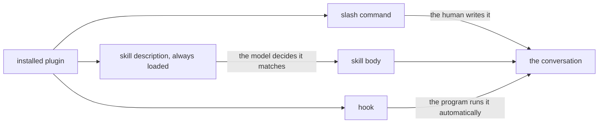

# How a plugin comes to apply

An installed plugin does nothing just because it is installed. Its content must enter
the conversation at some moment. Three different mechanisms do this, and each one works
in its own way. Most cases of "the plugin does not work" come from confusing them.

## A plugin enters the conversation in three ways

| Mechanism | Who decides | When it applies |
|---|---|---|
| Slash command | the human, explicitly | when the human writes the command |
| Description matching | the model, from the wording of the request | when the described situation occurs |
| Hook | the program, automatically | at the defined moment, without a decision |

In words, the three roads work like this. A slash command enters when the human writes
it. A hook enters when the program runs it, without asking anyone. On the middle road,
only the description enters first. The skill body arrives later, after the model decides
that the description matches the request.

### The slash command: the human decides

This is the most predictable road. `/ponytail ultra` does exactly one thing, immediately.

Two of the three plugins have commands: ponytail (6) and RTK (1). Ponytail decides how
much code gets written. RTK shortens the output of commands before that output reaches
the conversation.

**Superpowers has none.** The plugin has no `commands/` folder. Superpowers decides the
order of work. Its 14 skills are reachable only through the second mechanism. Each skill
loads only when its situation comes up.

This is the most important practical consequence in the whole document. For the most
substantial of the three plugins, the wording of the request is the only lever.

### Description matching: the model decides

Every skill has a `description` field. That field stays loaded in context all the time.
The model reads it and decides whether the skill applies. Only if the model decides that
it applies does the skill body load.

The descriptions in superpowers all follow the same template. They state the trigger
condition, never the method:

> Use when implementing any feature or bugfix, before writing implementation code

The wording does not say what the skill does. It says only when the skill applies.

### The hook: the program runs without asking

It runs without asking anyone. Ponytail injects its rule set on every `UserPromptSubmit`.
That is, on every message sent. For this reason, its mode stays active all the time. It
turns off only through an explicit phrase, "stop ponytail". Changing the topic does not
turn it off.

## Why the descriptions do not say what the skill does

This point is not obvious. It is documented as the result of testing, not of stylistic
preference.

The document `writing-skills/SKILL.md` describes what happened when a description
summarized the process. The description said "code review between tasks".

The agent did **one** review. But the diagram in the skill body called for **two**: first
spec compliance, then code quality. The description changed to "use when executing
implementation plans with independent tasks". It had no summary of the method. After
that, the agent read the diagram and did both reviews.

The explanation: a summary in the description becomes a shortcut. If the description
seems to say what to do, the skill body becomes optional text.

**The consequence for people who write prompts:** naming a skill is not the same as
applying it. The name brings the description into play. The behavior is in the body. A
prompt that describes the **situation** makes a read of the body more reliable than one
that names only the label.

The same rule applies in reverse for people who write skills. A description that
summarizes the method undermines its own content.

## Why "use skill X" is not enough

Direct wording works, and it is valid. Its limit lies elsewhere. It assumes that you know
in advance which of the 14 skills fits. For tasks that pass through several phases, the
right choice is not clear at the start. Those are the tasks where superpowers is worth
using.

The `using-superpowers` skill also sets an order for when several skills match. Process
skills come first. They fix the approach. Then implementation skills carry it to the end.
"Let's build X" leads first to `brainstorming`, then to implementation. "Fix this defect"
leads first to `systematic-debugging`.

This order is lost if the implementation skill is requested directly.

## The rejected alternative: everything through commands

An obvious solution would be to give each skill its own slash command, as ponytail does.
Superpowers explicitly chose otherwise. The reason shows in the structure of its
descriptions.

A command requires the human to know, at the start of the request, which phase applies.
But the right phase is often visible only after the code is read. A request written as
"add X" turns out to be "first understand why X is missing". Matching by description lets
the decision come after the situation is known, not before.

The cost is less predictability. The gain is that the right phase can be chosen in the
middle of the work, not only at the start.
