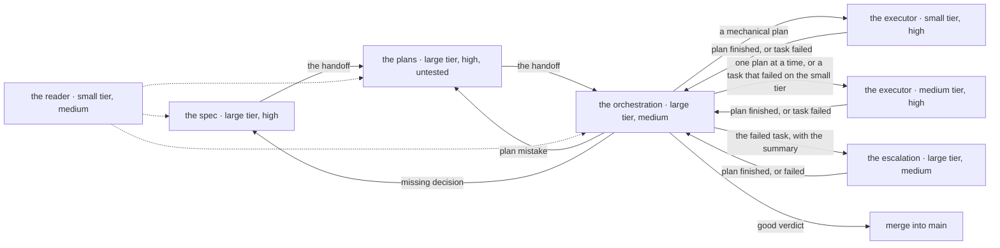

# Splitting the work across models

Not every part of a work item needs the same effort, or the same conversation.

This document explains why a work item with a written plan goes through three sessions and an executor. The sessions and the executor run on different tiers and effort levels. The document also shows where the line between them falls, and where local workers fit in. Local workers are models that run on one of the human's machines and take small tasks.

The framework has three model tiers: large, medium and small. In the plan header, the small tier is for the executor only. Effort has four levels: `medium`, `high`, `xhigh` and `max`. The module of each tool says which model each tier means for that tool.

## The cost comes from the conversation re-read at every step

A session is not billed for the human's messages. It is billed for **steps**. Every file read, every command and every sentence from the model is a step. One message can start dozens of steps.

At every step, the model receives **the whole conversation up to that point**. The part already seen costs little, because the server keeps it for a while. But it costs again at every step. It is like a notebook that is re-read before every question. Re-reading one page is cheap. But the notebook grows, and it is re-read hundreds of times.

Re-reading is more than half of the cost.

At the highest effort level, the thinking kept in the conversation is its thickest part. So a higher effort costs twice. It costs once when the model thinks. Then it costs again at every step after that. You can measure this at any time, from the machine's logs, by role, model and effort:

```bash
python3 bin/usage.py
```

**So the thickness of the notebook costs the most, not the model that writes.** Each rule below keeps the notebook thin. A new session does not re-read the discussion in which the work was decided. An agent keeps its own notebook.

## A work item passes through three sessions, and an executor carries the plans



The human opens three sessions, one after another: the spec, the plans and the orchestration. Between them passes the **handoff**. The handoff is the note in `STATE.md` for the next session. It gives the tier, the effort and the prompt to paste.

The orchestration session takes the plans one at a time. It gives each plan to an **executor**. An executor is an agent, a model started from a session. It runs on the medium tier. It runs on the small tier when the plan is mechanical.

A task that the executor cannot pass returns to the orchestrator. The orchestrator gives that task to the tier above. The task goes from the small tier to a medium-tier executor. It goes from the medium tier to a large-tier escalation agent.

The orchestrator checks each finished plan. It merges the plan into `main`, or it returns the work to the plans or to the spec.

The dotted lines show the **reader**, an agent on the small tier. Any of the three sessions can send the reader to read long material. The section "The reader keeps long pages out of the notebook" describes it below.

| Who | Tier and effort | What it does |
|---|---|---|
| **the spec**, session | large, `high` | talks with the human, settles the requirements, chooses the architecture, writes the spec. It does not write the plans |
| **the plans**, session | large, `high` | reads the spec and writes the plans and the work item's `README.md`. It does not test them |
| **the orchestration**, session | large, `medium` | gives each plan to an executor, checks it and merges it. It does not write the code |
| **the executor**, agent | medium, `high`, or small for a mechanical plan | carries a plan to the end, with one commit per task, and writes the report in the folder |
| **the escalation**, agent | large, `medium` | takes over the plan from the task the executor could not pass |
| **the reader**, agent | small, `medium` | reads long material for any session, and returns only what was asked |

The spec is the document that decides what is done and how. The plan is the list of tasks. Each task has its own verifier. The verifier is the command that says by itself whether the task succeeded.

Inside a session, the model does not change. A change makes the next step re-read the whole conversation from zero. An agent has its own conversation. So it can run on another model without touching the notebook of the session that started it. The effort can change inside a session too, without the server losing what it has kept.

## The test on one project showed about a quarter of the cost

The same request went from spec to merge twice. The request asked for a small Python tool that summarizes the log of a server. The bench, the tool that gives the same task to any variant of the framework, hid the acceptance tests from the agents.

The route with four sessions, on `max` and with the plan probe, cost about four times as much as the route described here. Most of the difference came from the spec and the plans.

Both routes passed the acceptance tests, with no escalation and no return. In the blind comparison, the human chose the result of the new route.

This is one small project, run once. The proportion shows the direction. It is not an average. Repeat the test with `bin/bench/bench.py journey`, on one variant of the framework at a time. For real work items, add up their sessions with `bin/usage.py`, over a few weeks in a row.

## The large tier sits where a mistake is expensive

There are three reasons, in order of weight.

**1. A wrong decision costs more than a wrong line.** An architecture choice is paid for in every session after it. A badly written function shows up at the first probe. The large tier stays at the spec, at the plans and at the verification, where a mistake is expensive and hard to see.

**2. Executing a good plan leaves nothing to decide.** The plan names the files, the code, the verifier and who does each task. What remains is careful work, not judgment. The medium tier is enough for that work, in an agent that did not carry the discussion.

Where the medium tier does not pass, the large tier takes over at `medium` effort. On Claude Code, one large-tier step at `medium` costs only a little more than one medium-tier step at `high`. So the escalation carries the plan to the end. It does not return to the medium tier after a single task.

A mechanical plan moves down one more tier, to the small tier. Each task has a command as its verifier, names its files and needs no decision. So the executor only copies carefully.

On Claude Code, the small tier costs a twentieth of the medium tier under 100,000 tokens in the request. Above that, where its price is multiplied by five, it costs a quarter of the medium tier. A task that the small tier does not pass goes up to a medium-tier executor. It does not go straight to the large tier. So a slip does not reach the most expensive model.

For the same reason, each agent carries its compaction threshold in its definition, in the
`autoCompactWindow` field. The reader, on Haiku, compacts at 100,000 tokens, so its requests stay
under the expensive rate. The target was 90,000, but the field does not accept less than 100,000.

The executor, on Sonnet, stays under 150,000 and compacts at 200,000. An executor started on Haiku
keeps the 200,000 threshold from its definition, so a plan on Haiku must be short. Workflow team
agents have no definition, so they have no threshold of their own.

The first three plans on the small tier write their cost and their escalations in the verdict. They write them next to the price of the same tokens on the medium tier. If the small tier costs more, it is dropped.

**3. Verification is cheap only with a thin notebook.** The orchestrator reads the plan, the executor's report and the branch diff. It does not read the executor's conversation. Then it runs the verifiers again. At `medium` effort that is enough. Verification does not invent. It compares.

## The plan goes out untested

Before, the plans session ran all the code of the plan in a copy of the repository before the handoff. That probe cost nearly four fifths of the plans sessions. Then the execution ran the same code a second time.

Now the code runs only once, at the executor. The plans session runs only a small probe. The probe checks that the tools and the commands the tasks need exist.

A mechanical mistake in the plan, such as a path, an anchor or a letter, is repaired by the executor. The executor writes the repair in the report. The executor does not take a design decision. It stops. The orchestrator then takes the decision to the human or to the plans session.

The risk is a plan mistake that shows only at execution. Its price is an escalation to the large tier for the rest of the plan. That price is far below the cost of the whole probe of each plan.

## The execution decisions are written in the plan header

The plan header is the first lines of a plan. It names the tier and who merges the work. The decisions for execution are written there. They are not left to the execution:

- **`Execution`**: the tier and the effort of the executor. The medium tier at `high` comes from the agent's definition. The small tier, for a mechanical plan, is given by the orchestrator at start. The effort `xhigh` for a plan with tasks to investigate, and `medium` for a purely mechanical plan, apply only to manual execution. Manual execution runs in a session that the human opens.
- **`Closing`**: who merges. It is the orchestrator, after the verdict. Or it is the human, after the verdict and a "yes". The human merges when the plan touches services, machines or keys, or deletes what cannot be recovered.
- **`Branch`**: where the executor works, so `main` stays untouched until the verdict.
- **`Who`**, on each task: the executor, the local worker with its model, or the human, with the verifier.

Choosing a worker is a judgment, so it is made in planning, with the table of models in front. The execution only follows the label. The procedure of the executor is the `execute` skill. The procedure of the orchestrator is the `orchestration` skill.

## What goes to the executor and what stays

Goes to the executor:

- the work of a written plan, entirely.

Stays in the session where it was decided:

- the discussion with the human.
- choosing the architecture and writing the plan.
- a small repair, without a plan. A new session would cost more than it saves.
- any answer that the human waits for now.

⚠ **The executor does not take decisions that the plan does not cover.** It stops and returns the question to the orchestrator. The orchestrator takes the question to the human. A decision improvised in the wrong way enters the code, and nobody has taken it. That mistake is paid for in redone work. That redone work costs exactly the saving the split was made for.

## How many at once: only one

A session starts only one agent at a time, and it waits for the result. The local workers take turns.

**Agents started at the same time stop at the same time.** They share the same reserve and reach it at the same moment. When they reach it, they do not return with half-done work. They return with nothing.

The incident that showed this is in the decisions register. A foreground agent ran a plan of almost one hour in a probe, with no interruption. So one agent is enough.

The local workers have another reason for the same answer: one video card. A second model, once loaded, unloads the first one.

## The local workers receive only what a machine can check

Small tasks, with a verifier, can go to a model that runs on one of the human's machines. They do not go to a model paid per token.

When the project that keeps the workers is present in the workspace, it has three things. The first is the bridge: the tool that gives the task to the worker, and returns the diff only if the verifier passed. The second is the command that prepares the machine. The third is the table that says which model can receive which kind of work.

For the delegation to be worth it, these things must be true:

- **a machine can say that the task succeeded.** If the verifier is the human, the task is not delegated. The verification would cost more than the saving.
- **the model is measured on that kind of work.** A row without numbers in the table means "not used".
- **an unvalidated result does not leave the bridge.** The change reaches the repository only if the verifier passed.
- **the gain is mostly in "reads a lot, returns little".** What the executor reads stays in its notebook until the end of the plan. What the local worker reads does not.

## An agent's report is not evidence

A worker, or an executor, that says "done, it works" has reported what it believes. What changed is read from the git diff. That it works is seen from the verifier, which the orchestrator runs again.

The rule is the same everywhere: **evidence before the claim**. Here it is easier to break, because the report sounds like a verification.

## The plan gives the tier, the human chooses the tool

The plan and the handoff do not name a tool. They name a tier, large, medium or small, with the effort. The module of each tool says which model that tier means for it. The handoff writes one line for each tool. The human chooses the tool at startup.

The reason is the quota. Each tool is paid from its own subscription, with its own limit.

When the limit of one tool is tight, a plan can be executed by hand in another tool. For example, when the Claude limit is tight, a plan can run by hand on Gemini in Antigravity. The orchestrator then checks it, as it checks any plan.

The spec, the plans and the orchestration stay on the large tier, the one the human trusts most. The rules, skills and records are the same. So changing the tool does not change how work is done.

The price is an extra check for each new tool. The check is that the tool loads all its rules, finds its skills, and that its module translates the tiers well. The steps are in [Add a new tool](../how-to/add-a-new-tool.md).

## What is not a reason to split

**A work item is not handed over to look more organized.** Each new session starts with the rules, the skills and the tools already loaded. That is tens of thousands of tokens before the first word. A repair of a few steps is finished more cheaply on the spot.

**Nothing the human waits for is delegated.**

If the question is "what do you think", the answer belongs to the session that the human talks with.
## The reader keeps long pages out of the notebook

A documentation page, a wide search through the code, or the long output of tests is read in a session. Such a read is re-read at every later step. Read by the reader, the same material stays in the reader's own conversation. The session then receives at most 2,000 tokens: what was found, with the exact quote and its source.

The reader does not read what the session must see whole:

- for the plans session, the spec.
- for the executor, the plan.
- for any session, the files that the session will change.

The session checks the decisive figures and commands itself, with a targeted search in the source. A summary can lose a figure or invent one.

## Compaction cuts the notebook at 400,000 tokens

Compaction replaces the old conversation with a summary. Its default threshold was close to the end of the window, close to one million tokens. So it ran very rarely. The framework sets it to 400,000. `bin/restore-env.sh` restores the setting on every machine.

After compaction, the rules, the memory and the skills in progress are reloaded from disk. The discussion becomes a summary. The framework already keeps what matters in the files of the work item's folder. So the summary must keep little. It keeps only the skill and the step in progress, the folder, the question that waits for an answer, and the decisions not yet written.
