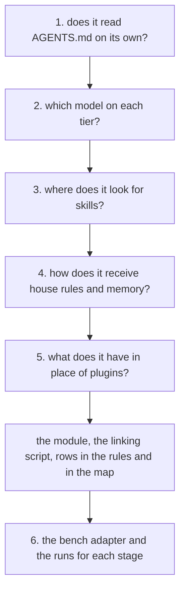

# Add a new tool

An AI coding tool works in the workspace like the others if it receives four things:
the shared rules, the tiered models, the house skills, and the house rules with memory.
This guide says what changes, based on how the tool answers five questions. Then it
says how to measure whether the tool works like the others.

The shared rules are in `AGENTS.md`. Every session loads this file, in any tool. What
belongs to a single tool is in its module, such as `CLAUDE.md` and `GEMINI.md`.



Take each answer from the tool's documentation. Then check it with a test: write a
unique word in a file, and ask the tool whether it can see that word.

## 1. Does it read `AGENTS.md` on its own?

Identify the names of the rule files that the tool loads, and the folders it loads them from.
Does it load them only from the open folder, or also from its parent folders?

| The answer | What to do |
|---|---|
| yes, from the open folder and from its parents | nothing: the shared rules arrive on their own |
| yes, but only from the open folder | local files in each repository and rules folder include the parent rules, one per include, as in Antigravity |
| no, it reads another file | its module takes the name that the tool looks for, and starts with an import of `AGENTS.md` |

Add a new module to `MODULE` in `bin/check-docs.py`, so that the check keeps the module
paired with its `AGENTS.md`. Without an `AGENTS.md` beside the module, or without the import
on the first line, the check fails.

## 2. Which model on each tier?

The plan header and the handoff write the tiers with the house names: large, medium and
small. Each tier also gets an effort level: `medium`, `high`, `xhigh` or `max`. The tool's
module receives the "Models by role" table. The table translates each tier into the tool's
model, and gives the identifier used to select it.

A tool that reads `AGENTS.md` on its own still gets a module if it works in roles. The tier
table has nowhere else to go.

## 3. Where does it look for skills?

The house skills are folders with a `SKILL.md` file. Each skill loads
when its situation comes up. The same files serve any tool that knows
the format, so they are not copied unless needed.

Determine the global folder where the tool looks for skills, and whether it follows symbolic
links. Test both with a test skill, linked in that folder, that answers one specific word.

- If it follows symbolic links, link the skills, as in `bin/antigravity.sh`.
- If it does not follow them, copy the skills. The script checks on every run that the copies
  match the source.
- If it has no skill loader, the module says how to load a skill, for example by reading its
  `SKILL.md`.

## 4. How does it receive house rules and memory?

The house rules are in `records/house-rules.md`. The memory index is in
`records/memory/MEMORY.md`. Both sit in the personal layer, which is the clone of the user's
private repository. Each tool receives them in its own way:

| Tool | How |
|---|---|
| Claude Code | a user rule, `~/.claude/rules/house-rules.md`, brings in the house rules. `bin/restore-env.sh` links the memory. |
| Antigravity | the local files of the open folder include both |
| Mistral Vibe | its global file, `~/.vibe/AGENTS.md`, written by `bin/vibe.sh`, copies both |
| a new tool | its own local file, written by its script and kept out of git |

The rules for writing memory are in `AGENTS.md`, under "Agent memory." So all tools write
to the same memory, in the same format.

## 5. What does it have in place of plugins?

In Claude Code, superpowers, ponytail, and rtk work through hooks. A hook is a small program
that the tool runs by itself at a set moment: at session start, on every message, or before
a command. For a new tool, find the equivalent:

| What the plugin does in Claude Code | What to find in the new tool |
|---|---|
| superpowers loads the `using-superpowers` skill at startup | an always-active rule that includes it, from the clone pinned in `plugins.lock.json` |
| ponytail sets its mode at startup and on every message | an always-active rule that contains the mode's text |
| rtk rewrites commands before they run | a hook that can rewrite commands. Otherwise, a rule that asks for `rtk` in front of commands. |

## What changes at the end

1. The tool's module, if it has something to say. Base it on answers 1 and 2.
2. A row in the "Tools" table in `AGENTS.md`.
3. Its row in the handoff, the note in `STATE.md` for the next session. Use the format in
   `skills/end-of-session/references/state-and-records.md`.
4. A `bin/<tool>.sh` script, modeled on `bin/antigravity.sh`. `bin/restore-env.sh` calls it
   only when the tool is installed. Its test goes in `tests/`.
5. Its rows in `IMPACT.md`, the impact map: the table of what breaks at each change, with the
   command that checks it.
6. A reference in `docs/reference/`. It records the tests run, what each one decided, and all
   the bench runs.
7. The adapter in `bin/bench/tools.py`, with its case in `tests/test-bench.py`.
8. The bench runs for each stage, with their reports, in the work folder.

Check from the root: `python3 bin/check-docs.py .`, the script's test, `python3 tests/test-bench.py`,
and the canary-word test in each rule file, on the new tool.

## 6. The bench adapter

The bench is the test bench in `bin/bench/`. It gives the same task to any AI coding tool.
It reads the tool's journal to check whether the tool followed the house rules. So it shows
whether the new tool works like the others.

The tool joins the bench through an adapter. The adapter is the class that the bench uses to
start a tool, answer it, and read its steps. It goes in `bin/bench/tools.py`. The rest of the
bench is shared.

A run starts the tool in the miniature workspace. The miniature workspace is a copy of the
workspace, in a temporary folder, where a test of the bench runs. At each question, the
simulated human answers. The simulated human is the model that answers in place of the human
in a bench run.

1. Determine from the tool's documentation how it runs without an interface. Identify the
   command that starts a conversation with a prompt and JSON output. Identify the command that
   continues it. Identify where it writes its journal.
2. Write the class, with its five operations. Call the tool's command through `run`, in the
   same file. `run` recognizes an exhausted quota.

   | Operation | What it does |
   |---|---|
   | `prepare(space, project)` | puts into the miniature workspace what the tool reads beside `AGENTS.md`: its local files and the memory link |
   | `start(project, prompt)` | the first call, with permissions open. Keeps the conversation ID. |
   | `resume(project, answer)` | the call with the simulated human's answer, in the same conversation |
   | `steps(folder)` | the conversation journal, in the common format |
   | `clean(output)` | copies the journal to `journal.jsonl`, and deletes what the tool left outside the miniature workspace |

3. Write the function that converts the journal to the common format, `steps_<tool>(journal, folder)`.
   First write its case in `tests/test-bench.py`, on a made-up journal. The case must fail at this point.
4. Add the class to the `TOOLS` dictionary. Add the function to `STEPS`, at the end of the file.
5. Run the control task. The report must show the question and the file write:

   ```bash
   python3 bin/bench/bench.py run --tool <tool> --model <id> --task bin/bench/tasks/short-check --output <runs folder>
   ```

6. Run the tasks of each stage, two per stage, using Claude's run on the same task as the
   reference. The runs folder usually sits in the work folder that adds the tool:

   ```bash
   python3 bin/bench/bench.py run --tool <tool> --model <id> --task bin/bench/tasks/spec-greeting --output <runs folder> --reference <Claude's run>
   ```

7. Read each failed check first, in the steps. If the tool worked correctly, the check reads the
   output wrongly. Then repair the check, with a case in the test. Otherwise, change the module or
   the skill, and run the stage again.

Do not weaken a check to make the tool pass. ⚠ Run the bench while no work happens in another
part of the workspace. The fingerprint sees every change, and the run then exits with code 4.
For the commands, the codes, and the checks, see [Bench reference](../reference/bench.md).
