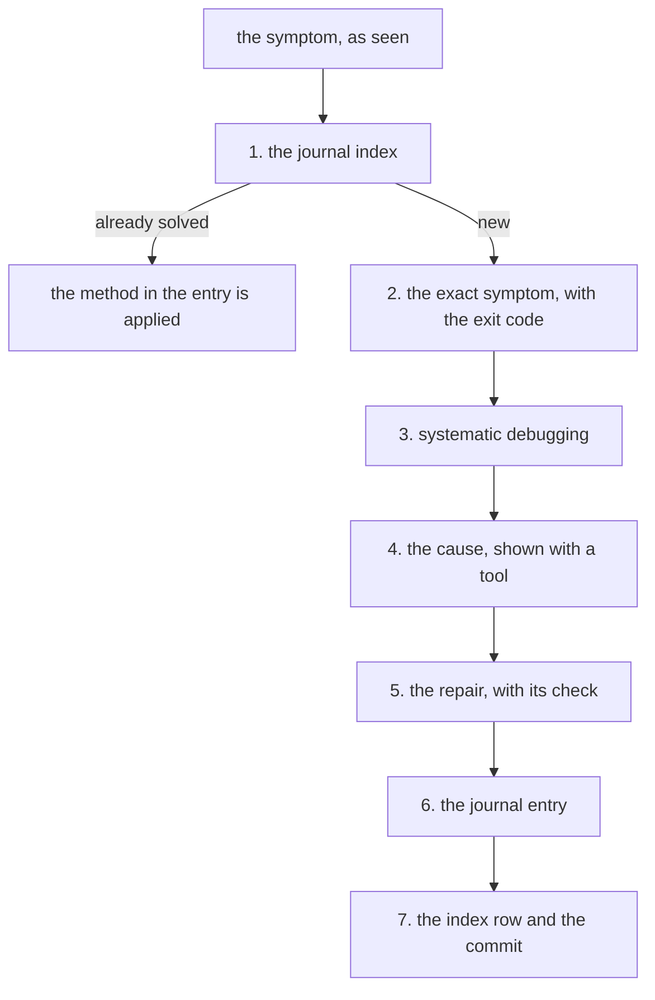

# How to solve an environment problem, and how it gets into the journal

An **environment** problem belongs to the machine or its tools: plugins, `node`, scripts, services, hardware. It does not belong to a project's code. A project's pitfalls (what cost time, and the method by which they were found) live in that project's `records/pitfalls/`.

Every resolution goes into the journal: the system problems solved, with the symptom, the cause and the method. The laptop and the environment are written in the journal of the personal layer (`records/`, the clone of the user's private repository, with its records).

A machine that a project maintains, or a project tool installed on the laptop, goes into that project's journal instead. That journal is kept in git.

This guide has two parts. The first part shows how to reach the cause. The second part shows how to write down what was found, so that it helps the next time.



First, search the journal index, because the problem may already be solved. If the problem is new, record the exact symptom, ask for systematic debugging, and show the cause with a tool. Do not guess the cause. Prove the repair on the command that failed. Then store everything in the journal and its index.

All commands run from the workspace root, the folder into which the environment repository was cloned. No path in this guide is absolute.

## 1. Check first whether it is already solved

It takes five seconds, and it avoids a second repair.

```bash
cat records/journal/INDEX.md
```

The index has a symptom column. The second time, a problem is recognized by what is **seen**, not by what it is called.

If the index shows nothing, search the text of the entries too:

```bash
/usr/bin/grep -rn -i '<word from the error message>' records/journal/
```

⚠ **Use `/usr/bin/grep`, not `grep`.** The shell function respects `.gitignore`. The framework ignores `records/`. A plain `grep` finds nothing there, and it does not say why.

## 2. Record the exact symptom, before any hypothesis

Record what was seen, not "the script does not work". Record the command that was run, the full output, and the exit code.

```bash
<command>; echo "code: $?"
```

An exit code is evidence, not a detail. In one real case, the hypothesis predicted code 127, but the run gave 1. That difference is what prevented a repair that would have left the true cause in place. There were two defects. The first one found was not the one that triggered the failure.

A symptom summarized by the person who lives it loses the detail that separates the hypotheses. If someone else reports the problem, ask for the exact form: how many, which ones, when, and whether it happens always or sometimes.

## 3. Ask the agent for systematic debugging

The wording below loads `systematic-debugging`. That skill is a set of instructions that enters the conversation when the situation matches. It requires hypotheses ordered by evidence, not guessed repairs:

```
<command> exits with <code> and writes <the exact output>. I do not know why.
Debug systematically. Do not propose the repair before the cause.
```

The skill orders the hypotheses. For each one, it asks for a command that can **disprove** it. It blocks the repair until the cause is shown, not just suspected.

⚠ **Never jump straight to "repair".** A repair applied to the symptom leaves the cause in place. It makes the problem look solved. In other words, it removes the problem from view until the second time, when it costs more.

## 4. The tools that find the cause most often

| The situation | What is run |
|---|---|
| a script stops silently | `bash -x script`. Read the **last line executed**, not the one that looks suspicious |
| a script with `trap … EXIT` | the trap is the last line run, so the line before it is where the script died |
| a service is silent | `journalctl -u <unit> -n 50 --no-pager` |
| a command works in a terminal but not in a service | run it through the service, with `sudo -k` before it and no `sudo` after it |
| you do not know where a program writes | start the program, then search for files modified in the last minute |
| a tool seems to skip something | ask **what was skipped**, not only what was found |

⚠ **The environment of the check is itself a tool.** It is the least verified tool of all. A terminal has `TERM`, `stdin`, a tty and, most treacherously, a `sudo` timestamp. A systemd service has none of them. A check that runs under conditions unlike production can make a false explanation look true for years.

## 5. Prove the repair on the command that failed

The check is the command that showed the symptom. The problem is not solved until the symptom disappears on **the same command** that showed it.

```bash
<the command that failed>; echo "code: $?"
```

⚠ **The check must also be able to fail.** If the check passes on the old code too, it proved nothing. The check runs in pairs. With the repair removed, it must fail. With the repair restored, it must pass.

## 6. Write the journal entry, in the same session

Write the entry **in the same session**, while the evidence is still on screen. Rejected hypotheses are forgotten on the day they are rejected.

The file name:

```
records/journal/YYYY-MM-DD-short-subject.md
```

The date comes first, so alphabetical order matches chronological order. The file system does the sorting, not a field that someone keeps up to date by hand.

The title is the **symptom**, not the diagnosis. The second time, a problem is recognized by what is seen, not by the name it was later shown to have:

- ✅ "`restore-env.sh` exits with 1 without writing anything, although the restore succeeded"
- ❌ "A problem with `pipefail` in the chain of fallbacks"

The body has three parts, and none of them is optional.

### The symptom

Record what was seen, exactly, with the output in a code block. Also record what was **supposed** to appear and did not. An absence is harder to notice than a presence, so it is written down.

### The cause, with evidence

The command that showed the cause, and its output. Not the explanation, but the **evidence** that the explanation comes from. If several things combine to produce the defect, count them: "three things combine, and none of them alone would be enough."

### The method, stated in general terms

This is the part that can be reused. The result belongs to the problem. The method does not.

An entry without a method is a result, not a lesson. In six months, nobody will have the same problem again. But anyone can have a problem of the same shape.

Rejected hypotheses are also written here, with the reason. Without them, someone will try them again. A plausible hypothesis that proved wrong is exactly the kind of thing that gets retried.

## 7. Add the entry to the index, then commit

The new entry gets a row in the table in `records/journal/INDEX.md`. The row has three cells:

| Cell | What it contains |
|---|---|
| 1 | the **symptom**, as seen, not the diagnosis |
| 2 | the date, `YYYY-MM-DD` |
| 3 | a Markdown link to the file, with the file name twice: once as text, once as target |

The target is relative to `records/journal/`, because the index lives there. So the target is only the file name, with no folder before it. A path written from the root looks right on a visual check. It fails in `bin/check-docs.py`.

Use a row that already exists in `INDEX.md` as the model. Copy it and change its three cells. The convention is at the top of the same `INDEX.md`. The machine is written in the entry, under "Where".

Then run the check and the commit:

```bash
python3 bin/check-docs.py . && git add -A && git commit -q -m "<what was learned, not what was changed>"
```

---

## Prompts to use

**Starting the debugging**, which loads `systematic-debugging`:

```
`./bin/restore-env.sh` exits with code 1 and writes no error message, although the
restore seems to have succeeded. The last line written is "skill documentation linked",
and the line that reports success is missing.

Debug systematically. Do not propose the repair before showing the cause.
```

Why this works: it gives the exact command, the exit code, the last line seen **and** the missing line. Then it explicitly asks for the method.

**When there is already a suspicion.** State it as a suspicion, not as a fact:

```
I suspect it comes from `pipefail`, but the observed code is 1, and my hypothesis would
give 127. Check the hypothesis before we use it, and say whether the code disproves it.
```

Why this works: it names the prediction **and** the observation that does not support it. A hypothesis that predicts a different exit code from the one seen is wrong, even if the defect it describes is real.

**When the repair is ready and must be proven:**

```
Show the check: run the command that failed. Then remove the repair, and show that
the check really fails without it.
```

**When it is time to write the journal entry:**

```
Write the journal entry for this: the symptom, the cause with evidence, and the method
stated in general terms. Include the hypotheses we rejected, with the reason.
Add the row to the index.
```

## A complete example, from symptom to entry

This is how the case went that produced the entry "`restore-env.sh` exits with 1 without writing anything". The entry is found by its symptom in `records/journal/INDEX.md`.

1. **The measured symptom:** the script did everything it had to do. It cloned four marketplaces, installed four plugins and wrote the configurations. Then it exited with 1, with no message. The final line that reports success was missing. A separate check showed that the restore succeeded.
2. **The first hypothesis, plausible but wrong:** variable names with diacritics. The defect was real, but it would have given code 127, and the observed code was 1. It was kept as a second defect, not as the explanation.
3. **The cause, found with `bash -x`:** the last line executed was the second fallback in the chain that searches for the binary. `find` on a folder that does not exist exited with 1. With `pipefail`, that failure code survived the `head` step, and `set -e` stopped the script. So the third fallback, the only one that really found the binary, never ran.
4. **The method written in the journal**, as three general rules: an observed exit code is evidence. `set -e` plus `pipefail` reduces a chain of fallbacks to a single attempt. A script that stops silently is read with `bash -x`, not by eye.

The fourth part is the only one that is still useful six months later.
