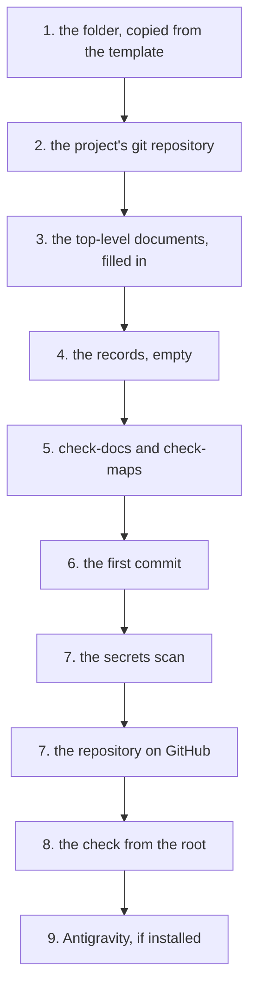

# How to start a new project

The guide takes you from "nothing exists" to a project with its own repository. The top-level documents are filled in. A copy goes to GitHub. It takes about a quarter of an hour. The writing part is the longest.

The environment is assumed to be already restored, with the steps in [Quick start](../../README.md#quick-start). If `./bin/check-lock.sh` does not exit with 0, solve that first.

⚠ **Run the commands marked "from the root" from the workspace root**, the folder into which the environment repository was cloned. Run the rest from the project folder. A command run from the wrong folder creates folders in the wrong place, without an error.

No path in this guide is absolute. The steps work wherever the repository was cloned.

## The steps, in short



The folder starts as a copy of the template and becomes its own git repository. You fill in and check the top-level documents. Then you make the first commit. Before GitHub, you scan what leaves for secrets. At the end, the root must see the project with its remote. Antigravity, if installed, receives its rules.

## 1. Copy the template into a new folder

Projects live in `projects/`, each with its own repository. The folder name uses lowercase letters and hyphens, because it also becomes the repository name. The template (the `template/` folder, from which a new project starts) is copied whole.

From the root:

```bash
mkdir -p projects/<name> && cp -r template/. projects/<name>/ && ls -a projects/<name>
```

`AGENTS.md`, `CLAUDE.md`, `README.md`, `IMPACT.md`, `STATE.md`, `.gitignore`, `docs/`, and `records/` must appear.

⚠ **`cp -r template/. dest/`: the dot matters.** Without it, `cp -r template dest` creates a `template/` inside the destination, instead of copying its contents.

## 2. Create the repository in the project folder

From the root:

```bash
cd projects/<name> && git init -b main
```

From here on, run the commands from the project folder.

The repository is created in the project folder, not at the root. The root is the environment repository. It ignores `projects/`, so that the two do not mix.

## 3. Fill in the top-level documents

The four copied files have placeholders in angle brackets. Fill them in this order, because each one builds on the one before:

| Order | File | What is written |
|---|---|---|
| 1 | `README.md` | what the project is, in at most three lines. Then "How it works", with the diagram. Then "Quick start" and "The map". At the bottom, "Why it is made this way" and "The landmarks, re-measured". |
| 2 | `AGENTS.md` | only what is **specific** to the project. Name the commands. Name what is source, and what is a copy pulled from another machine. Name the order in which the code is read. Name what is not touched. |
| 3 | `IMPACT.md` | what breaks if X changes, with a verification command on every row |
| 4 | `STATE.md` | the state measured today and the work of the next session |

What deserves attention in each:

- **`README.md`**: the sections come in template order. Each has, in angle brackets, what is written in it. The rows of "The map" that point to `IMPACT.md` and to `STATE.md` are **not deleted**. Without them, whoever opens the project searches the folder for what they should have found on the first page.
- **`AGENTS.md`** is the file with the shared rules that every session loads, in any tool. The `CLAUDE.md` beside it imports it. These two are the only pair allowed to disappear completely. Every session loads them at start. A file with empty sections costs something each time and tells the reader nothing.
- What was copied into `AGENTS.md` from the template is a list of questions. If none of them has an answer for this project, delete both files. Delete also the row in the map in `README.md` that points to `AGENTS.md`.
- The most frequently skipped question is the first one. **Ask whether a folder in the repository is a copy of something from another machine.**
- If so, a change made there is lost at the next sync. It is lost to exactly the person who was not warned.
- **`IMPACT.md`** is the impact map: the table of what breaks with each change, with the command that checks it. A row without a verification command is a claim that ages silently. The fourth column is mandatory.
- **`STATE.md`** is the state file: the project state and what comes next, rewritten at the end of every session. Write it at the **end** of the first work session, not at the start. Until then, it has no state to describe.

## 4. The records start empty

`records/` holds the records. A record is a series of dated entries. Entries are appended. They are never rewritten. It is the fifth kind of document, and the only one that **is not rewritten**.

Each entry is a standalone file, with its date in its name. Leave it untouched after you write it. Only the `INDEX.md` of each folder is rewritten, because it is the map of the entries, not one of them.

| The folder | What goes into it |
|---|---|
| `records/pitfalls/` | what cost time, whose method of finding is reapplied |
| `records/journal/` | system problems solved on the project machines: a missing package, a driver, an environment setting |
| `records/decisions/` | the project decisions, with the reason and history of each |
| `records/work/` | the work items with a plan, each in a folder with spec, plans and `README.md`. The index keeps the state and the backlog. |

All four start empty, each with an `INDEX.md`. Write the first entry **in the session in which the thing it describes happened**, not later. A month on, "I know I repaired something about this" cannot be reconstructed from anything.

⚠ **A record never goes under `docs/`.** There, documents are rewritten. A rewrite of a record loses its old entries.

## 5. Run the first check, before the first commit

```bash
python3 ../../bin/check-docs.py . && ../../bin/check-maps.sh .
```

It must print `failures: 0` and `failed: 0`.

⚠ **If `check-maps.sh` says `commands run: 0`, `IMPACT.md` was not filled in.** Zero commands run is not a pass. It is a check that looked at nothing.

## 6. The first commit says why the project exists

```bash
git add -A && git commit -q -m "<why the project exists, in one sentence>"
```

The message says why, not what. `git diff` shows what changed. The reason cannot be reconstructed later. No commit carries `Co-Authored-By` or any other trace of a tool.

## 7. Put a copy on GitHub, after the secrets scan

Scan what leaves **before** the push, not after:

```bash
git ls-files -z | xargs -0 /usr/bin/grep -InE '(api[_-]?key|token|password|secret)[[:space:]]*[:=][[:space:]]*["'\'']?[A-Za-z0-9_/+.-]{12,}|BEGIN [A-Z ]*PRIVATE KEY|ghp_'
```

⚠ **The list comes through `-z` and `xargs -0`.** Written as `$(git ls-files)`, the command silently skips files with spaces in their names. In an imported game, that is half of them.

If the scan finds no match, create the repository and push:

```bash
gh repo create <name> --private --source=. --remote=origin --push
```

Check that it arrived:

```bash
git status -sb | head -1 && git rev-list --count origin/main..main
```

`## main...origin/main` and `0` must appear.

## 8. The root sees the project with its remote

From the root, the new project must appear with its remote:

```bash
for p in projects/*/; do
  if [ "$(git -C "$p" rev-parse --show-toplevel 2>/dev/null)" = "$(cd "$p" && pwd -P)" ]; then
    printf '%-26s %s\n' "$(basename "$p")" "$(git -C "$p" remote get-url origin 2>/dev/null || echo 'no remote')"
  else
    printf '%-26s %s\n' "$(basename "$p")" 'NOT A REPOSITORY'
  fi
done
```

`NOT A REPOSITORY` next to the project means step 2 did not create the repository in its folder. The loop first compares the repository root. [The structure of the workspace](../reference/structure.md) explains why.

## 9. Give Antigravity the project's rules, if it is installed

Antigravity does not climb above the opened folder. So a new project cannot see the framework rules on its own. It receives them through a local file, written from the root:

```bash
./bin/antigravity.sh
```

At the end, `folders with local files:` must appear, with a number one more than before. The files, `.agents/rules/framework-NN.md`, are written to `info/exclude` in the project repository. So they do not enter commits. Without Antigravity, skip this step.

---

## Starting prompts

What you write in the session, once the folder exists. The wording matters. It brings the right skill, or it brings nothing. A skill loads only when your words match its situation.

⚠ **Open the session in `projects/<name>`, not at the root.** Only then do the project rules load when the session starts, in any tool. The work item, the journal and `STATE.md` also end up in the project's records, not in the environment's.

The framework rules also load from there, because the root is a parent. The framework is the repository with the shared rules, skills and tools.

**When it is not yet known what is being built**, brings `brainstorming`. It asks questions before it writes code:

```
I want us to build <what>. I do not have the requirements fixed yet. Let us clarify them first.
```

**When the requirements are clear and the work has several steps**, brings `writing-plans`. It writes a plan with checkable steps:

```
The requirements are fixed: <list>. Write the execution plan before you touch code.
```

**When the plan exists and is being executed**, brings the `execute` skill. Open a **new** session for this. Use the model named in the plan header, which is in the first lines of the plan. The header also names who merges the work:

```
Execute the plan records/work/open/<folder>/<plan>.md with the execute skill.
```

**When new code is being written**, brings `test-driven-development`:

```
Write <what>, with the test before the implementation.
```

**When it is done and must be proven**, brings `verification-before-completion`:

```
Run the checks and show the output, not the conclusion.
```

**When the documentation comes next**, brings the `documentation` skill. The values must already be verified:

```
Write the project documentation, following the Divio model.
```

## A complete prompt, as an example

This is what a request that leads straight to work looks like. It has the context the agent needs:

```
New project: projects/network-measurements.

What I want: a script that measures the latency to three hosts every five minutes
and writes the results to a CSV, so that I can see when the link drops.
It runs on a small machine, so python3 with no new dependencies.

I copied the template and ran git init. I do not have the requirements fixed. I do
not yet know whether I want an alert when it drops, or only the file.

Start with the discussion, not with the code.
```

Why it works:

- It names the folder.
- It says what must happen, and on which machine.
- It declares the only technical constraint.
- It says what is **not** decided.
- It explicitly asks for the stage to start from.

## What is done at the end of the first session

`STATE.md` is written by `end-of-session`, with what was measured in the session. The shape of the state file, and what goes into it, is in the skill.
