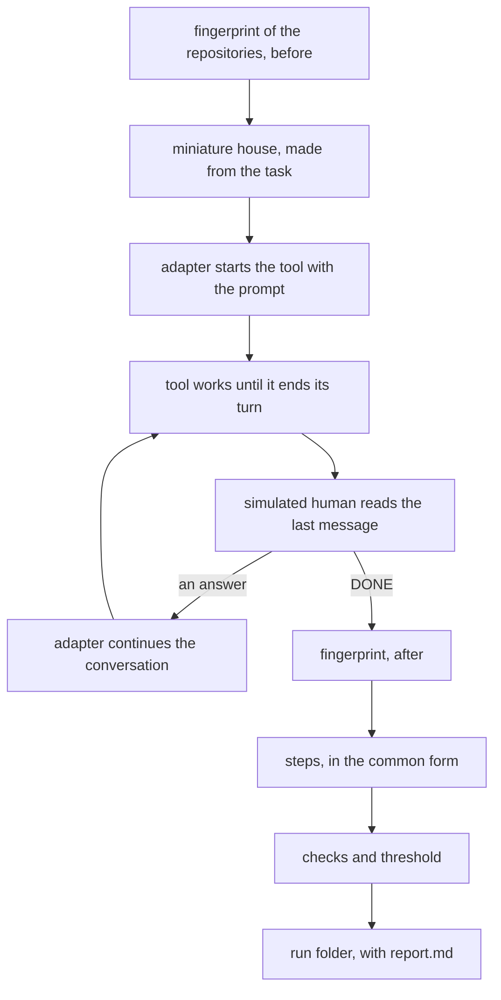
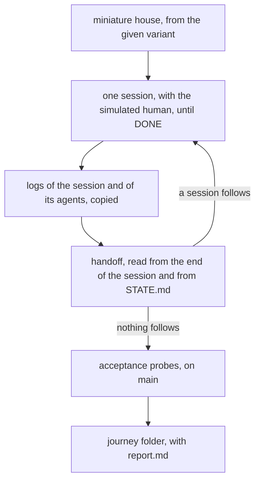

# Bench

The bench runs one task on Claude Code, on Antigravity or on Mistral Vibe, with no interface. It writes a report with the checks. The bench lives in `bin/bench/`. It gives the same task to any AI coding tool. It also reads the tool's log to see whether the tool followed the framework's rules.

On Claude Code and on Vibe, the bench also runs a whole project, from spec to merge. It uses a variant of the framework. A variant is a copy of the framework, with its own rules and skills. Two architectures can then be compared on the same request. This reference lists the commands, what they write, and what a new tool must provide.

## One run



In short, the bench takes a fingerprint of the real repositories. Then it builds the miniature house. The miniature house is a copy of the workspace, in a temporary folder, where a bench run works. The adapter is the class that starts a tool, answers it, and reads its steps. The adapter starts the tool with the prompt of the task.

After each finished turn, the simulated human reads the last message and answers. The simulated human is the model that answers in place of a person in a bench run. When it writes `DONE`, the bench takes the fingerprint again. Then it runs the checks on the steps, and it writes the run folder.

## Files

| File | What it holds |
|---|---|
| `bin/bench/bench.py` | the commands, the miniature house, the loop with the simulated human, the fingerprint, and the report |
| `bin/bench/tools.py` | the adapters, one class per tool, and the reading of the logs in the common form |
| `bin/bench/checks.py` | the checks |
| `bin/bench/tasks/<stage>-<subject>/` | the tasks |
| `tests/test-bench.py` | the test, with fake tools that write made-up logs. It uses only the standard library. It needs no network and no quota. |

## Commands

```bash
python3 bin/bench/bench.py run --tool agy|claude|vibe --model <id> [--effort <e>] --task <folder> --output <folder> [--reference <run>] [--minutes <n>] [--manners]
python3 bin/bench/bench.py read --tool agy|claude|vibe --log <log.jsonl> --stage spec|plans|execute|search [--folder <folder>] [--task <folder>]
python3 bin/bench/bench.py profile --after <YYYY-MM-DD> --output <file>
python3 bin/bench/bench.py journey --project <folder> --output <folder> [--tool claude|vibe] [--variant <framework>] [--note <file>] [--label <label>] [--model <m>] [--effort <e>] [--sessions <n>] [--minutes <n>] [--budget <$>] [--manners] [--same-model]
python3 bin/bench/bench.py journey --resume <journey folder>
python3 bin/bench/bench.py blind --a <journey> --b <journey> --output <folder> --key <file>
```

### `run`

One task, on one tool, with the simulated human.

| Option | What it takes |
|---|---|
| `--tool` | `agy`, `claude` or `vibe` |
| `--model` | the model identifier, as the tool takes it. On `vibe`, it is the profile in `~/.vibe/agents/`, for example `execute`. For a model of the house, it is the alias, for example `my-local-model`. `--effort` adds its level to the alias. |
| `--effort` | only for `claude`: `medium`, `high`, `xhigh` or `max` |
| `--task` | the task folder |
| `--output` | the folder in which the run folder is made |
| `--reference` | the folder of another run. Its written files appear next to this run in the report. |
| `--minutes` | the time limit of the run, and of one single turn of the tool. Default 90. |
| `--manners` | the manners checks become required on this run |

Exit codes:

| Code | What it means |
|---|---|
| 0 | the run ended, whatever the checks gave |
| 1 | another error. The report is still written, with the reason. |
| 3 | the quota of the tool ran out. The bench reads it from `RESOURCE_EXHAUSTED`, `usage limit` or `rate limit`. Or Vibe reached its money limit, `price limit`. The run does not count. |
| 4 | something changed outside the miniature house. The list of changes is in the reason, followed by the reason of an earlier failure, if there was one. |

Limits: 30 answers from the simulated human, and the time in `--minutes`. When a limit is reached, the run ends with the reason `the cap on answers` or `the cap on time`.

### `read`

Checks on a log that already exists. Use it to judge a run again after a check is repaired. Use it also on a conversation of the Antigravity app. Its log is at `~/.gemini/antigravity/brain/<conversation>/.system_generated/logs/transcript_full.jsonl`.

| Option | What it takes |
|---|---|
| `--tool` | `agy`, `claude` or `vibe`, by the form of the log. Conversations from the app have the form of `agy`. |
| `--log` | the path of the log |
| `--stage` | `spec`, `plans`, `execute` or `search` |
| `--folder` | the folder to which the paths in the log are relative. It is the project of the session, or the `project/` of a run. |
| `--task` | the task folder, or the folder of a run, which keeps a copy of `task.json` |

It prints one row per check, with `✓`, `✗` or `–`. The last row is `threshold: passed` or `threshold: not passed`. It exits with 0.

### `profile`

It collects the Claude Code sessions in `~/.claude/projects/*/*.jsonl`. It keeps the sessions that began on the day in `--after` or later. It sorts them by the skills they call: execute (`execute` or `executing-plans`), plans (`writing-plans`) and spec (`brainstorming`).

Sessions left over from the bench, under a key `-tmp-bench-*`, are skipped. The file in `--output` has, for each kind, how many sessions passed each check. It also lists the sessions, with what failed.

### `journey`

A journey is a test project, from spec to merge, on Claude Code or on Vibe. The bench does what a person does. It opens the sessions of the framework one by one. The first session gets the request of the project. Each next session gets the handoff of the session before it. The handoff is the note in `STATE.md` for the next session.



In short, the bench builds the miniature house from the variant. It runs one session with the simulated human, as `run` does. When the simulated human writes `DONE`, the bench copies the logs of the session and of its agents. Then it reads the handoff. If a session follows, the bench starts it with the role, model, effort and prompt from the handoff. Otherwise, the bench runs the acceptance probes on `main`. Then it writes the journey folder.

| Option | What it takes |
|---|---|
| `--project` | the folder of the test project |
| `--output` | the folder in which the journey folder is made |
| `--tool` | `claude` by default, or `vibe`. On `vibe`, the profile of each session comes from its role. Its cost is what it added to the shared VIBE_HOME of the house, with the agents started from the terminal too. |
| `--variant` | the framework from which the miniature house is made. Default: the root of the workspace. |
| `--note` | a file put in the rules of the variant's miniature house, as `<house>/.claude/rules/variant-note.md` |
| `--label` | the name of the variant in the name of the journey folder. Default: the name of the framework. |
| `--model`, `--effort` | the model and effort of the first session, the spec. Default `opus`, with no effort. On `vibe`, an alias of the house, such as `my-local-agent`, takes all roles. Spec, plans and orchestration use the alias profile for the level. Execution uses `my-local-agent-execute-<level>`. |
| `--sessions` | the limit of sessions. Default 10. |
| `--minutes` | the limit of one session, and of one single turn of the tool. Default 150. |
| `--budget` | the dollars at API price after which no new session starts. Default 80. |
| `--manners` | the manners of each session become required on this journey |
| `--same-model` | with `claude`, each session runs on `--model` and `--effort`, not on the model from the handoff |
| `--resume` | the folder of a journey that stopped because of the quota or an error. Use it without the other options. |

A model reads the handoff, as a person would. It is the medium tier on Claude Code, called with `claude -p --safe-mode --json-schema`. It gets the last texts of the session. It also gets `STATE.md` from "The next session" onward. It returns the role, model, effort and prompt. The end of the session has priority, because the state file may be left over from an older session.

A handoff that repeats the prompt of the session that just ended counts as `nothing follows`.

| Code | What it means |
|---|---|
| 0 | the journey ended, whatever the acceptance probes gave, and after a limit |
| 1 | another error. The miniature house stays, and `--resume` continues from the session that was cut off. |
| 3 | the quota ran out. The rest is the same as code 1. |

A journey project has:

- `project.json`, with `name` (the folder in `projects/`), `request` (the prompt of the first session, word for word), and `layers` (as for tasks, default `["template"]`).
- `brief.md`, for the simulated human.
- `acceptance/probe.py`, the acceptance probes. They get the folder of the project. They print "N of M passed". They exit with 0 only if all of them pass. They stay outside the miniature house, so the agents do not see them.
- `project/`, optional, the starting files.

A journey writes the folder `<YYYY-MM-DD-HHMM>-<label>-<name>/` in `--output`:

| File | What it holds |
|---|---|
| `journey.json` | the state, written again after each session. It has the variant and the sessions. Each session has its role, model, effort, prompt, time, answers of the simulated human, steps, tokens, agents, cost, and the reason it ended. At the end, it has the acceptance, the escalations, the returns, and the total cost and tokens. |
| `report.md` | the same figures, as a table, with the output of the acceptance probes |
| `sessions/<NN>-<role>/` | `log.jsonl`, `human.jsonl` and `agents/`, the logs of the agents, each with a `.meta.json` |
| `project/` | the project at the end, with `.git` |

The cost comes from the logs. It uses the prices in `bin/usage.py`, for the session and its agents. Escalations are the `escalation` agents. Returns are the spec and plans sessions that come after the first execution or orchestration.

### `blind`

It puts side by side the results of two journeys of the same project. A person can then judge them without knowing which variant is which. The order is drawn by lot. `A/` and `B/` in `--output` hold the `main` of each project, without `records/`. The records tell how the work was done, so they would also tell the variant. The file given in `--key` says which letter is which journey. It exits with 0.

## The simulated human

A model of the medium tier, called with `claude -p --safe-mode --system-prompt <its rules and brief.md> --no-session-persistence --tools "" --model sonnet`. It gets `brief.md` of the task. It also gets the last three texts of the tool in the current turn, at most 6,000 characters.

| The message of the tool | The answer |
|---|---|
| a question with options | the number of the recommended option, unless `brief.md` asks for another |
| a request for approval | "yes", unless `brief.md` asks for something else |
| a question of fact | the answer from `brief.md`. Where `brief.md` says nothing, the answer is what a person who wants something simple would give. |
| stopped without a question, unfinished | "continue" |
| finished: the final report, or the prompt of the next session | exactly `DONE` |

## The miniature house

It is in `/tmp/bench-<12 hexadecimal digits>/`. The path has no dots. The bench deletes it on any exit.

The framework comes from the variant. The variant is the root of the workspace, or the folder given with `--variant` to `journey`. The personal layer always comes from the root.

| What | Where it comes from |
|---|---|
| `AGENTS.md`, `CLAUDE.md`, `GEMINI.md`, `MISTRAL.md`, `.gitignore`, `plugins.lock.json` | copies of the ones in the variant, as they are on disk when the run starts |
| `bin/`, `skills/`, `agents/` | links to the ones of the variant |
| `.vibe/` | only for `vibe`: the VIBE_HOME of the house, written by the variant's `bin/vibe.sh`. It is kept out of git. |
| `<house>/.claude/skills/`, `<house>/.claude/agents/` | copies of the skills and agents of the variant |
| `<house>/.claude/rules/` | copies of the user's global rules in `~/.claude/rules/`, the user's `~/.claude/CLAUDE.md` with its imports expanded, as `personal.md`, and the note of the variant |
| `<house>/.claude/settings.json` | the settings written by `bin/merge-claude-config.py` of the variant, in an empty HOME. These are the plugins, the option that loads `AGENTS.md`, and what else the variant sets. |
| `records/` | `template/records/` of the variant, plus copies of the personal layer, when there is one |
| `records/local-workers.md` | a file of local workers, with no worker in it |
| `projects/<project>/` | the layers from `layers`, by default `template/`, then the `project/` of the task |

Claude Code takes the house of the variant from here, not from `~/.claude`. The adapter starts it with `--setting-sources project,local`, `--settings <house>/.claude/settings.json`, and `--add-dir <house>`. Otherwise, a personal skill from `~/.claude/skills/` would win over the skill of the variant with the same name. That is the order in the Claude Code documentation.

The root and the project are each a git repository, on `main`, with a commit "Start of the trial". Neither has a remote. The bench identity appears only on the commit command, with `git -c`.

## Tasks

Each user adds their own tasks in `bin/bench/tasks/`. The template ships with no tasks.

A task folder `bin/bench/tasks/<stage>-<subject>/` has:

- `task.json`, with the fields below.
- `brief.md`, for the simulated human: what the user wants, and what it answers for each kind of question.
- `project/`, the starting files of the project, laid over the layers.

| Field | What it holds |
|---|---|
| `stage` | `spec`, `plans`, `execute` or `search`: the checks that apply |
| `prompt` | exactly what the user would paste into the new session |
| `project` | the name of the folder in `projects/` |
| `layers` | the folders in the root, copied first into the project. Default `["template"]`. Use `[]` for none. |
| `web_search` | the task asks for facts from outside. Otherwise `search-before-spec` does not apply. |
| `new_request` | the task asks for a new spec, with `request.md`. A missing file fails the task. It does not count as not applicable. |
| `plan` | the path of the plan to execute, for `verifiers-run` |
| `plan_with_code` | the work asks for code, so a plan without code fails `code-in-plan` |
| `helper` | the framework agents, of which the task asks for at least one to be called, for `helper-called`: `reader`, `helper` |
| `answer` | the patterns, as regular expressions, that the texts of the model must all contain, for `answer-correct` |
| `probe` | a shell command. It runs in the project at the end. It passes with exit code 0, for `answer-correct`. |

A plans task has the folder of the work, with the spec, in `project/`. An execute task has the spec and the plan too. So the session starts where the previous session would have left it.

## Steps

The adapter turns the log of the tool into a list of steps. It writes one JSON row per step, in `steps.jsonl`:

| Field | What it holds |
|---|---|
| `row` | the number of the model's answer. The steps of one answer have the same `row`. |
| `turn` | how many times the human answered until then. The first prompt is turn 0. |
| `kind` | `human`, `text`, `read`, `write`, `command`, `search`, `page`, `question`, `skill`, `subagent`, `reminder` or `other` |
| `tool` | the original name of the tool called, for example `Write` or `write_to_file` |
| `target` | the path, command, search or address. A path in the project is relative to `--folder`. |
| `text` | the text in the chat, for `human` and `text`. The question, for `question`. |

- **`human`** is also the answer given in a window of questions. In Claude Code, it is the result of `AskUserQuestion`. In the Antigravity app, it is the result of `ask_question`, as `A1: …`, without the label "(Recommended)". `A1: User Skipped`, which `agy` gets from the terminal, is not an answer of the human.
- **`reminder`** is a message that the tool itself slips in. For example, the reminder hook of Antigravity slips a reminder to Gemini after some tools.
- **`skill`** is a call of the Skill tool, or a reading of a `SKILL.md`. The name of the skill is in `target`.

## Checks

Each check gets the steps. It returns `✓`, `✗` or `–`. The dash means not applicable: the run does not need the check. The check gives the reason on one row. An error inside a check shows as `✗`, with "error in check".

The threshold is the result of a run. It passes when no required check failed. In `run`, it also needs exit code 0.

| Check | Stages | Required | Rule it comes from |
|---|---|---|---|
| `git-state` | all | yes | `AGENTS.md`, "The state of the repository is read first" |
| `impact-read` | all | no | `AGENTS.md`: before the first change, `AGENTS.md` and `IMPACT.md` are read |
| `state-read` | spec, plans | no | the handoff (the note in `STATE.md` for the next session) is in `STATE.md` |
| `commit-without-prefix` | all | yes | `AGENTS.md`: commit messages have no prefix such as `docs:` |
| `commit-without-coauthor` | all | yes | `AGENTS.md`, "Commits carry no `Co-Authored-By`" |
| `framework-subagents` | all | yes | `AGENTS.md`, "One subagent at a time, in the foreground, only from the framework's agents". Only `reader`, `executor`, `escalation`, `helper` and `worker`, with `run_in_background: false`. Never two in the same response. |
| `skill-announced` | all | no | `AGENTS.md`, "Every skill invoked is announced" |
| `skill-announced-in-time` | all | no | the reminder of Antigravity: the announcement comes in the response to the call, or in the next one |
| `text-beside-writes` | all | no | `AGENTS.md`, "The session tells the human what it did, what came out and what comes next" |
| `end-of-session` | spec, plans | no | `AGENTS.md`, "At the end of the session everything is committed and pushed" |
| `percent-told` | all | no | the same rule: how much is done, in percent |
| `helper-called` | search | yes | the instructions of the models of the house: at least one of the agents named in `helper` is called. Without the `helper` key, the check does not judge. |
| `answer-correct` | search | yes | the task itself: the patterns of the answer and its probe, from `task.json` |
| `questions-before-spec` | spec | yes | `superpowers:brainstorming`: at least two turns with questions before the spec |
| `one-question-per-message` | spec | yes | `superpowers:brainstorming`: one question per message |
| `search-before-spec` | spec | yes | `AGENTS.md`, "Variants and the spec rest on verified facts" |
| `spec-folder` | spec | no | `AGENTS.md`, "A planned work item has a folder" |
| `only-records-in-spec` | spec | no | `AGENTS.md`, "The spec and the plans are written in different sessions" |
| `design-approved` | spec | yes | `superpowers:brainstorming`: a "yes" from the human before the spec |
| `spec-shown-to-human` | spec | yes | `superpowers:brainstorming`: an answer from the human after the spec, before `STATE.md` is written |
| `check-docs-run` | spec, plans | yes | the `documentation` skill |
| `details-before-plan` | plans | no | `AGENTS.md`, "The plan header is written by the planning session" |
| `plan-form` | plans | no | `details.md`, "The plan" |
| `code-in-plan` | plans | yes | the `plans` skill, § 2: the whole code, not described |
| `only-records-in-plans` | plans | yes | the glossary: the planning session does not write the code |
| `execute-called` | execute | yes | `AGENTS.md`, "The order of the skills" |
| `branch-before-commit` | execute | yes | the `execute` skill, § 1 |
| `test-before-code` | execute | no | `superpowers:test-driven-development`. The `./test` runner counts as the test. |
| `verifiers-run` | execute | yes | the `execute` skill, § 2: the verifiers of the plan. It needs the plan, so it applies only with `--task`. |
| `yes-before-merge` | execute | no | the `execute` skill, § 5 |

The checks `helper-called`, `answer-correct` and `reader-after-two-pages` are required for the `search` stage.

## What a run writes

The run folder is `<YYYY-MM-DD-HHMM>-<tool>-<task>/`, in `--output`. A second run in the same minute gets `-2` at the end.

| File | What it holds |
|---|---|
| `report.md` | the date, the time, the answers of the simulated human, the cost, the tokens, and the reason it ended. Then the threshold, the table of checks, and what the tool wrote in the work folder, with its commits. The same for `--reference`. Then the table of steps. |
| `meta.json` | the same figures, for the program: `tool`, `model`, `effort`, `task`, `stage`, `date`, `duration_s`, `answers`, `cost`, `tokens`, `reason`, `code`, `threshold` and `checks` |
| `steps.jsonl` | the steps, in the common form |
| `human.jsonl` | what the simulated human received, and what it answered |
| `log.jsonl` | the raw log of the tool |
| `task.json` | a copy of the task, for judging again |
| `project/` | the project at the end, with `.git` |

The cost in dollars comes only from Claude Code. It comes from `total_cost_usd`. `agy` gives tokens, from `usage.total_tokens`.

The bench does not write `.gitignore`. The runs folder of a work item keeps the large files out of git with two lines: `**/log.jsonl` and `**/project/`. The rest goes into git.

## Safety

The tools run with open permissions: `agy --dangerously-skip-permissions`, and `claude --permission-mode bypassPermissions --permission-prompts none`. Each starts with a clean environment. It has only `HOME`, `PATH`, `TERM`, `LANG` and `USER`. The bench keeps the tools in a box:

- **a project with no remote**: it cannot push anywhere.
- **`sudo` with a password**: the system stays untouched.
- **limits**: the answers, the time, and, in `journey`, the sessions and the budget.
- **the fingerprint**, taken before and after the run:
  - each git repository in the workspace, down to four levels below the root, by `git status --porcelain -uall` and `git diff HEAD`.
  - `crontab -l`.
  - the names in `~/.config/systemd/user`, `~/.local/bin`, `~/opt` and `~/.local/state`.

A difference gives exit code 4. ⚠ The fingerprint also sees the changes of the human. A run while the human works in another project exits with 4. The steps of the tool are then read by hand before the run counts.

On Claude Code, the project memory key of the miniature house, `-tmp-bench-*`, is deleted after the run. So `profile` does not count the sessions of the bench.

A network or server failure (`EAI_AGAIN`, `ECONNRESET`, or a 5xx answer) is retried three times, 60 seconds apart. If the turn started, the session resumes with a message that says what happened.

## Adapter

A tool joins the bench with a class and a function in `bin/bench/tools.py`:

| Operation | `agy` | `claude` |
|---|---|---|
| `prepare(workspace, project)` | writes the local files `.agents/rules/framework-NN.md` of the project, with the function `local_file` from `bin/antigravity.sh` | links the memory of the project key to its copy in the miniature house |
| `start(project, prompt)` | `agy -p <prompt> --model <m> --dangerously-skip-permissions --output-format json --print-timeout <s>`. The conversation id comes in `conversation_id`. | `claude -p <prompt> --session-id <uuid> --model <m> [--effort <e>] --permission-mode bypassPermissions --permission-prompts none --output-format json --setting-sources project,local --settings <house>/.claude/settings.json --add-dir <house>` |
| `proceed(project, answer)` | the same, with `--conversation <id>` | the same, with `--resume <uuid>` |
| `steps(folder)` | `~/.gemini/antigravity-cli/brain/<id>/.system_generated/logs/transcript_full.jsonl`, through `steps_agy` | `~/.claude/projects/*/<uuid>.jsonl`, through `steps_claude`. The logs of the agents are kept apart, in `<uuid>/subagents/`. |
| `clean(output)` | copies the log to `log.jsonl` | copies the log, and deletes the key `-tmp-bench-*` |

The class also has `name`, `cost` and `tokens`. It has the constructor `(model, effort)`. It registers in two dictionaries at the end of the file: `TOOLS`, for `run`, and `STEPS`, the function that reads the log, for `read`.

The steps, one by one, are in the guide [How to add a new tool](../how-to/add-a-new-tool.md), at "6. The bench adapter".
