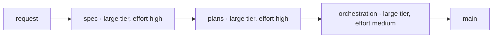

# Documentation — the details

Read this file **once per session**, when writing starts.
Re-read `SKILL.md` at every decision. Do not re-read this file.

---

## The four kinds in `docs/`, in detail

The short table is in `SKILL.md`. The rules of each kind are here.

### Tutorial

A guided lesson. It takes someone who knows nothing and leads them, step by step,
to a **visible result**.

- **Must** work every time, without exceptions.
- **Must** say exactly what is typed and what must appear.
- **Does not** offer options, alternatives or "it can be done this way too". They confuse.
- **Does not** explain why. The explanation distracts from learning.
- Ends with "what was learned" and links to the next step.

A project usually has **only one**. Three tutorials in one project are probably
how-to guides in disguise.

### How-to guide

A recipe. It answers a question that only someone with some experience could ask.

- **Must** have ordered, numbered steps.
- **Must** be called "How to do X". Never a vague title such as "Configuration".
- **Does not** explain concepts. It links to the explanation and moves on.
- **Is not** complete. Practical use matters more than completeness.
- Leaves room for adaptation. The reader's situation differs from the example.

The difference from a tutorial: *a tutorial is what you decide must be known.
A guide answers a question asked by someone who already works.*

⚠ **Two guides with the same preliminary checks.** This happens often and produces
copied blocks. Write the shared checks **once**, in a third document. Both guides
link to it.

### Reference

The description of the mechanism. Dry, exact, complete.

- **Must** mirror the structure of the system, not the logic of the reader.
- **Must** use tables, lists and values.
- **Does not** teach anyone anything.
- **Does not** say why. It says only what exists and which value it has.
- All values are the **real** ones, checked, not assumed ones.

### Explanation

The discussion. The reasons, the rejected alternatives, the context and the
pitfalls belong here.

- **Must** answer "why this way and not another".
- **Must** also say what was tried and did not work.
- **Does not** give instructions.
- Can be read away from the computer, like an article.

## The record, in detail

A series of entries, not a text: the pitfalls, the journal, the decisions, the work items.

- **One file per entry**, never a file that grows.
- **Dated in its name.** This is the opposite of `docs/`, where the date is forbidden.
- **Not edited after it is written**, except to fix a wrong fact.
- **The index is the only part that is rewritten.** It is the map. The entries are the facts.
- **Not read in order.** The reader searches by entry.
- **No documentation run goes into `records/`.**

## The layout on disk

```
README.md              what the project is, and the map of the five kinds
docs/
├── README.md          table of contents, and the difference between the kinds
├── tutorial/          usually a single document
├── how-to/            one per problem, named "How to do X"
├── reference/         one per area of the system, plus glossary.md
└── explanation/       one per subject that needs understanding
records/
└── pitfalls/ journal/ decisions/ work/    one file per entry, dated in its name
```

---

## "Why", not "what": the long examples

An example of what **not** to do, in the MSDN style:

> `setTimeout(callback, delay)` — calls `callback` after `delay` milliseconds.

The signature already says that. What is missing: why anyone would use
it, what pitfalls it has, and what happens if `delay` is 0.

Compare:

- ❌ "The setting is `system.automount=0`."
- ✅ "The obvious setting (`merged.device=internal`) has no effect, because the
  function that mounts always calls the external variant. The right setting is
  `system.automount=0`, which makes the script exit before it looks for an
  external card."

---

## For a reader from outside

The four rules from `SKILL.md`, section 3, with their examples. The reader already uses
Claude Code, but has not seen the house. They do not know what a handoff is, what
a work item's folder is, or what the personal layer is.

### The gloss at first use

- ❌ "Execution reads the handoff and works on the branch."
- ✅ "Execution reads the handoff (the note in `STATE.md` for the next session) and
  works on the branch written in the plan header."

Copy the gloss from the glossary, where it is the first sentence of the entry. This
keeps it the same in every document. A word without an entry gets its gloss first
in the glossary, then in the document. From its second use in the same document,
the word stands alone.

### The ⚠ sign, only where silence costs

The question is one: what is lost if the reader skips the sentence?

- ✅ "⚠ A test without the execute bit never runs, and nothing says so." Without the
  sentence, the test is missing from the suite and nobody finds out.
- ❌ "⚠ Skills brought in by the application are not pinned here." Without the
  sentence, nothing is lost. It is information, so it is an ordinary sentence.

### The heading says what is done

- ❌ "## Reading goes down, writing climbs"
- ✅ "## At the closing, what was found is written at the first level that contains it
  whole." The aphorism, if it helps, stays in the text below.

### The diagram, with the text that says it in words



The text next to it: "A request passes through three new sessions: the spec, the plans
and the orchestration. The orchestration gives each plan to an executor, checks it,
and merges it into `main`." Without this text, screen readers and `check-docs.py` would
see nothing of the diagram.

Draw the diagram before merging. The "diagrams" configuration in `.claude/launch.json`
serves the workspace root on port 8766. In the browser of the application, open
`bin/diagrams.html?doc=<path of the document>`. The page draws every `mermaid` block
and writes "good" or the error in its title.

From a project in `projects/`, copy the configuration into the project's
`.claude/launch.json`. Add `"--directory", "../.."` to the arguments. The server must
serve the workspace root, where the page sits.

---

## Pitfalls: the template and the example

A pitfall is a **record entry**, not a paragraph in an explanation. Its place is
`records/pitfalls/`, one file per entry, dated in its name.

Anything that cost time is worth writing. But **the method is worth more than the
result**, because it can be applied again.

Template:

> ### The title of the pitfall
>
> **The symptom**, as seen from the outside.
>
> **The cause**, with concrete evidence.
>
> **Why it is a pitfall and not just a quirk:** usually because the obvious
> check passes, and the symptom appears later.
>
> **The method that caught it**, stated in general terms.

A real example:

> A save placed in the folder given by the configuration has the right name, the
> right size and the right checksum. Any reasonable check passes. And yet the game
> starts from zero, because the emulator looks somewhere else.
>
> The check that catches this is not about the file, but about the program. Start the
> game, then search for the files modified in the last minute. Where one appears,
> that is where the program looks.

### The evidence

When a claim matters, write **how it was checked**.

- "The panel is Panel 4" → weak
- "155 of 155 initialization commands identical, identical timing, identical
  physical size" → checkable

For visual changes, the evidence is a compared capture, not a reading of code:
"zero pixels different out of 307,200".

### The rejected alternatives

Also write what was **not** chosen, with the reason. Otherwise someone will try
them again.

A document that says "what cannot be done, and why" saves more time than many guides.

---

## The excuses

Every row below was said at the end of a long day, when the documentation was the
last thing left. The rows are here so the reader recognizes them when they appear,
because all of them sound reasonable at the moment someone says them.

| The excuse | The reality |
|---|---|
| "The code explains itself" | The code says **what** it does. Why it was chosen and not another does not show in any line. |
| "I'll document after I finish the feature" | The rejected alternatives are forgotten on the same day they are rejected. |
| "I'll write only the README now, the rest later" | "Later" is exactly the moment when the reason can no longer be reconstructed. |
| "I know this value, I won't check it again" | A value written from memory is an assumption that looks like a fact. It looks identical to a checked one. |
| "It's obvious why it was done this way" | Obvious now, to the one who did it. Not in a year, and not to someone else. |
| "The pitfall is too specific to this project" | The result is specific. The method that caught it is not, and the method is written down. |
| "I'll make a single document, it's easier to find" | A document that does all four is good at none. That is the first rule. |
| "I'll add an alternative to the tutorial too, it's more complete" | A tutorial with options is no longer a tutorial. Completeness is the job of the reference. |
| "I'll add this pitfall to the others, in the same file" | That is how a file reaches 4078 lines. A pitfall is a record entry, not one more paragraph. |

They all mean the same thing: write now, with the values checked now.

---

## A project that already exists

Why does the skill have a separate rule for this case? Its earlier versions said
"write X" everywhere, and nowhere what happens when X already exists. The second run
wrote a second document about the same thing. The first one stayed alongside, just
as visible and just as wrong.

1. **Read the code and the history** before writing a line. Documentation written
   from assumptions is worse than none.
2. **Check every value** on the real system, not from memory.
3. **Look for what cost time**: in commits, in comments, in repeated fixes.
   That is where the pitfalls are.
4. **Ask what you cannot find out alone:** which alternatives were rejected, and why.
   The reasons are never in the code.

---

## Rewriting existing documentation to the standard

Apply this list when a whole documentation set goes through the rules in `SKILL.md`,
sections 3 and 5. Rewrite each document once, whole, in the order a new reader meets
them: the README, the glossary, the tutorial, then the rest.

Do not make one pass per rule. A pass for the glosses, then one for ⚠, then one for
the headings would touch each document four times. It can also spoil the pass before it.

1. **The README** has, in order: what it is, a diagram of how it works, the quick
   start, and the map. The reasons for this form and the landmarks sit at the bottom.
2. **Write the glossary first**, because the glosses are taken from it. Start each
   entry with the short gloss, of at most about 12 words, plain to someone from
   outside. The house nuance comes after.
3. **Every house word has its gloss at first use**, in every document.
4. **⚠ stays only where silence costs.**
5. **Headings say plainly what is done.**
6. **Every flow with more than three parts has a Mermaid diagram**, drawn without
   error with `bin/diagrams.html`.
7. **No failure and no value lost.** Run from the project's root:

   ```bash
   python3 ../../bin/check-docs.py .
   python3 ../../bin/values.py main README.md docs --removed <the work item's folder>/removed-values.tsv
   ```

   The first exits with 0 failures. The second exits with 0 only when every value
   that disappeared is written in the removed-values file. The file has one line per
   value, with a tab between the value, the document and the reason. The orchestrator
   reads the file at the check.

The paths of the tools start from the workspace root. `../../` is the way from a
project in `projects/`. `values.py` compares documents written in the same language.
For a translation, the check stays `check-docs.py` plus the orchestrator's check.

---

## The person, with examples

Instructions use the imperative. Descriptions use the third person.

- ✅ "Open the variables file." · "The script checks the state first."
- ❌ "You open the file." · "If you want, you can…" · "The variables file is opened.", as an instruction

Documentation is read by someone else too, and in a year. Addressing the reader
with "you" ages badly and assumes a dialogue that no longer exists.

## The commit message, with examples

- ❌ "Documentation update" · "Added ai-server.md"
- ✅ "The inference server works, and the key closed the panel"

## Where the material comes from

Gather **the pitfalls** from `superpowers:systematic-debugging`. What the template
above asks for (the symptom, the cause with evidence, the method stated in general
terms) is exactly what systematic debugging produces.

Gather **the rejected alternatives** from `superpowers:brainstorming`. That is where
the variants are rejected, and also where they are lost if nobody notes them at the
moment of rejection.

If someone caught the defect methodically, the material already exists. If they
caught it by luck, the material does not exist. **Do not invent it.**

---

## A work item's folder

`records/work/open/<YYYY-MM-DD-subject>/`, with the date of the first spec or plan.
In projects organized by domain, the domain comes before the state:
`records/work/<domain>/open/<folder>/`.

| The file | For whom | Who writes it, and when |
|---|---|---|
| `README.md` | human | planning, together with the plan |
| `request.md` | human and agent | the human's request, word for word, when a written one existed |
| `<folder>-design.md` | agent | planning: the spec |
| `<YYYY-MM-DD-subject-plan>.md` | agent | planning: the plan, one or more |
| `closing.md` | human | at closing, through `end-of-session` |

### The plan

The form is the house's, not the template of `superpowers:writing-plans`. That skill
gives the method: small tasks, the test first, the whole code. The form, the language
and the names belong to the house. The full example is the plan in `example/`,
`2026-09-22-greeting.md`.

- **The name:** `<YYYY-MM-DD-subject>.md`, in the language of the repository. When the
  work item has several plans, each one carries its own subject.
- **The header**, under the title: `> **For whoever executes:**`, with the `execute`
  skill. Then `**Execution:** <small, medium or large tier>, effort <effort>.` Then
  `**By hand:** effort <xhigh or medium> — <why>.`, then `**Closing:** <the orchestrator or the human> — <why>`,
  `**Branch:** execute/<name>`, and `**Criteria:** C1, C3`. The criteria are the ones
  from the spec that the plan closes, or `**Criteria:** none — <why>`. The command
  `python3 bin/check-docs.py --criteria <folder>` fails on a criterion from the spec
  that is in the header of no plan.
  Write the small tier only in a mechanical plan. In a mechanical plan, each task has a command
  as its verifier, names the files it touches, and asks for no decision.
- **Under the header:** write `**The goal:**`, `**Spec:**`, with the link, and
  `## Constraints for every task`.
- **Each task:** write `### Task N: <what it does>`, then `**Who:** session`, `bridge`
  or `the human`, with the reason, and `**Verifier:**`, with the command and what it
  prints. The steps are `- [ ] **Step N:**`, left unticked.
- **The tests** live in `tests/`, and the `./test` of the project runs them. They use
  only the standard library and need no network. Data from outside comes from a file
  saved next to the test.
- **The commits** in the steps follow the rule in `AGENTS.md`: one sentence that says
  why, without prefixes.

### The folder's `README.md`

The work item's version for people. Execution does not read it. Write the sections in
this order:

1. **What is pursued**: what is achieved, said for someone outside the field.
2. **Why now**: what happened, or what is missing.
3. **The steps, without code**: one sentence per task.
4. **The debatable decisions, with their risk**: so the human can overturn them.
5. **What the work item does NOT do.**
6. **How to see that it succeeded**: a command or a visible result.
7. **Where the rest is**: the spec, the plans, the request.

Write without untranslated jargon. Give every number with the sentence that says
why it matters.

### `closing.md`

Write it once, before the folder is moved into `closed/`. It is also for humans.

```markdown
# Closing: <the title of the work item>

Date: <YYYY-MM-DD> · State: <finished · partial · abandoned · replaced by …> · Closed by: <the orchestrator · the human>

## What came out
<the first line: "The work item cost X $ and Y% of the weekly limits", from `usage.py --work <folder>`>
## Deviations from the plan
## The leftovers, each with its destination

| The leftover | The destination |
|---|---|
| <the task not done, or the point from "What is not in this plan"> | done · abandoned, because … · backlog |

## Where the evidence is
<the commits, the branch, the verifiers run at closing>
```

## The decision

`records/decisions/<YYYY-MM-DD-subject>.md`, with the date of the decision.

```markdown
# <the rule or the choice, as a sentence>

Date: <YYYY-MM-DD> · Requested by: <the human, or the work item it came out of> · Replaces: <the old decision, if any>

## The decision
## Why
## The history
<the incident, the numbers, what was tried>
## The rejected alternatives
## Where it applies
<the section in AGENTS.md or the module, the skill, the file>
```

A changed decision gets a new entry. The old entry is not touched. Its row in the
index gains "replaced by".

## The rule in `AGENTS.md` or a module

```markdown
### <the rule, as a short sentence>

<the exact form: what is done, when, with which command>

Reason: <one sentence>.
History: <a link to the decision, pitfall, journal or folder>.
```

The link goes where the history is already kept. Write a new decision only when the
history existed only in the text of the rule.

## Moving a record file

Search the whole workspace first for a record file that is moved or removed, not only
the repository that moves it. An entry may be quoted as an example from any project.
The plan that moves it does not have that project on its map.

```bash
git grep -l 'records/journal/<entry-name>.md' -- projects README.md AGENTS.md CLAUDE.md GEMINI.md STATE.md
```

A match in a repository the plan does not touch does not stop the move. It requires
updating the reference there, with the human's consent. Usually this is a separate
commit in that repository. ⚠ If the move sits on an unmerged branch, the new reference
is valid only on disk. In a fresh clone it is broken until the merge. "Identical on
GitHub" answers only "is content lost?", not "who else points at this path?".
